  
  
  
  

## 🌼 Hi, I'm Sofía

I'm a Computer Science Engineering student at **Universidad de Chile** (expected 2027). I like the place where mathematics meets computing, and I'm looking to get into research.

## 🔭 What I'm exploring

| | |
| --- | --- |
| **Theory of computation** | What can be computed, and at what cost: computability, complexity and the limits of algorithms. |
| **3D geometry** | Geometry processing and shape analysis. |

I'm early on both and learning through coursework. If you work on related topics and take students, I'd love to chat.

## 🌱 Looking for

Research assistantships, thesis projects and collaborations with academic groups.

## 🛠️ Things I've built

- **[DashAI](https://www.dash-ai.com/)**: rebuilt the app's asynchronous job queue across a Python backend and a React frontend (Huey, Pickle → Dill serialization, FastAPI).
- **Security scan automation at Accenture**: reverse-engineered an undocumented API to automate scans, cutting the monthly effort from up to 12 hours to 1–2.
- **ETL pipelines at Cybertrust Latam**: Python and pandas on large tables, plus SAP role-inheritance graph analysis.
- **[sofiaa.cl](https://sofiaa.cl)**: my portfolio, a bilingual desktop-style site in React and TypeScript ([source](https://github.com/levitaet/levitaet.github.io)).
- Peer tutor in Differential and Integral Calculus since 2024.

## 🧰 Tools

<b>🇨🇱 Leer en español</b>

### 🌼 Hola, soy Sofía

Soy estudiante de Ingeniería Civil en Computación en la **Universidad de Chile** (egreso esperado 2027), reconocida como Alumna Destacada en 2024 y 2025. Me gusta el punto donde se juntan la matemática y la computación, y busco involucrarme en investigación.

### 🔭 Qué estoy explorando

- **Teoría de la computación:** qué se puede computar y a qué costo; computabilidad, complejidad y límites de los algoritmos.
- **Geometría 3D:** procesamiento geométrico y análisis de formas.

Estoy partiendo con ambas y las aprendo en mis cursos. Si trabajas en temas afines y recibes estudiantes, me encantaría conversar.

### 🌱 Busco

Ayudantías de investigación, proyectos de tesis y colaboraciones con grupos académicos.

### 🛠️ Cosas que he hecho

- **[DashAI](https://www.dash-ai.com/):** reestructuré la cola de tareas asíncronas de la aplicación entre un backend en Python y un frontend en React (Huey, serialización de Pickle a Dill, FastAPI).
- **Automatización de escaneos de seguridad en Accenture:** ingeniería inversa de una API no documentada para automatizar escaneos; el esfuerzo mensual pasó de hasta 12 horas a 1–2.
- **Pipelines ETL en Cybertrust Latam:** Python y pandas sobre tablas grandes, y análisis de grafos de herencia de roles en SAP.
- **[sofiaa.cl](https://sofiaa.cl):** mi portafolio, un sitio bilingüe estilo escritorio en React y TypeScript ([código](https://github.com/levitaet/levitaet.github.io)).
- Tutora par de Cálculo Diferencial e Integral desde 2024.

[Descargar CV](https://sofiaa.cl/cv-sofia-araya-es.pdf)

 

  <picture>
    <source media="(prefers-color-scheme: dark)" srcset="https://raw.githubusercontent.com/levitaet/levitaet/output/github-snake-dark.svg">
    
  </picture>

